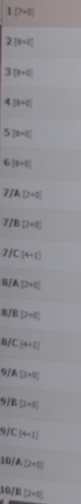

# Previo-források visszakeresése és biztonságos átadása – 2026-11-07
Feladó: Work. Címzett: Claude és Sárberki projektvezető. Hatókör: visszakeresés, dokumentálás; nincs Previo-írás, foglalás, kódmódosítás vagy telepítés.

## Kiindulás és módszer
Az aktuális tesztági AGENTS.md teljes szövege beolvasva; blob: `6e5fe86490bb3ea070ca53c272914a726d44ca43`.
Ellenőrzött HEAD: `a12150b917316b686bf1258839174a0972a08fe4`, ág: `gmail-test-subject-allowlist`; a HEAD export-restore és safety ellenőrzése SUCCESS (run 42344225934), több más feladat SKIPPED. Ez nem teljes alkalmazásteszt.
A #9 helyes kommunikációs csatorna. Claude meglévő `docs/PREVIO-TEST-23-EGYSEG-2026-11-06.md` dokumentuma (`97b6cf6`) felhasználva, változatlanul hagyva.
A legkisebb megfelelő megoldás: a meglevő eredetik leltározása, korábbi elemzések újrahasznosítása, egy szükséges kép adatmentes kivágata és mezőszintű bizonyítéklista. Nem újraelemzés és nem új integráció.

## Eredmény
| Anyag | Ellenőrzés | Állapot |
|---|---|---|
| Négy megnevezett 09-24/25-i Markdown | Mind a négy teljesen visszaolvasva, eredeti bájtjaik letöltve | MEGTALÁLVA / FELDOLGOZVA |
| További kapcsolódó átadási dokumentum | `Sarberki_Previo_konkurencia_atadas_2026-09-25.md`, teljesen visszaolvasva | MEGTALÁLVA / FELDOLGOZVA |
| Szeptemberi Previo-videórészletek | 25 `IMG_6055*.mp4` fájl letöltve, ffprobe-hossz és vizuális mintaképek ellenőrizve | MEGTALÁLVA; nem 25 független felvétel |
| Régi Previo-képek | 11 PNG (9 képkocka-összesítő + naptárkép + kapacitás-közelkép), 24 JPEG képernyőkép/közelkép | MEGTALÁLVA |
| Kapacitásbizonyíték Claude számára | Egy vendégadatmentes, vizuálisan ellenőrzött PNG-kivágat és 23 soros CSV | FELDOLGOZVA; e dokumentum melléklete |
| Egybefüggő 21–23 perces eredeti | A vizsgált forrásokban nem azonosítva | NEM IGAZOLT |
| Pontosan hat fájl = 14:45,9 | Korábbi szövegek állítják; a mostani fájlokhoz nem sikerült egyértelműen hozzárendelni | NEM IGAZOLT |
| Claude tényleges elolvasása | A GitHubon átadott anyag későbbi feldolgozása külön visszajelzést igényel | NEM IGAZOLT |

A 9 összesítőben kézzel megszámolva 116 képkockapanel van. Ez nem 116 külön eredeti képfájl és nem 116 bizonyítottan egyedi jelenet. A külön naptárkép és kapacitáskivágat ezen felül értendő. Az ismételt képeket/videókat nem számoljuk új bizonyítéknak. Új mintaképek csak a belső azonosítást szolgálták, nem régi kinyert képkockaként jelentjük őket.

## Hol vannak a források?
Az eredeti fájlok a tulajdonos meglévő ChatGPT-fájltárában változatlanul megvannak. Pontos nevük, Library- és fájlazonosítójuk, forráslinkjük, méretük és a letöltött eredetik SHA256-a: [source-inventory.json](source-inventory.json).
A linkek tulajdonosi forráslinkek; Claude közvetlen hozzáférése ezekhez NEM IGAZOLT. A jelen dokumentumhoz, CSV-hez és megtisztított PNG-hez ugyanazon GitHub-ágon hozzáférhet; nem kell a személyes eredetiket megkapnia.

### Azonnal használható korábbi elemzések
| Dokumentum | Forrás |
|---|---|
| Sarberki_Horgaszto_teljes_projektexport_2026-09-24.md | [Eredeti](https://chatgpt.com/library?file_id=libfile_a8e2820b3a7c81919f8b482d61596e87&account_id=personal); különösen a 09-24/25-i Previo-szakaszok |
| Sarberki_mentes_2026-09-24_kiegeszites.md | [Eredeti](https://chatgpt.com/library?file_id=libfile_8d54f38d3c608191b17cebc9a84ea871&account_id=personal); kapacitás, voucher, pénzügyi és auditmezők |
| Sarberki_teljes_projektatadas_5_6_Sol_2026-09-25.md | [Eredeti](https://chatgpt.com/library?file_id=libfile_6214f3a4d3d08191a1607449fb5ed7ed&account_id=personal); 4–9. szakasz |
| Sarberki_teljes_biztonsagi_mentes_2026-09-25.md | [Eredeti](https://chatgpt.com/library?file_id=libfile_5b3a6597159c819190f59d029f7f4ee2&account_id=personal) |
| Sarberki_Previo_konkurencia_atadas_2026-09-25.md | [Eredeti](https://chatgpt.com/library?file_id=libfile_03ed8dc4f51481918ca65f41b380dc17&account_id=personal); történeti háttér, nem aktuális API-állapot |

Az eredetik teljes szövegét nem publikáltuk újra. Az alábbi kivonat tartalmazza a jelen feladathoz szükséges, személyes adat nélküli megállapításokat. Régi üzleti szabály nem írja felül a jelenlegi jóváhagyott szabályt.

### A 25 szeptemberi videófájl azonosítása
A megtalált fájlok 1:25,9–4:04,2 hosszú részletek. A fájlnevek nem bizonyítanak önálló videót; az azonos hosszú, egyező mintaképes változatok ismételt feltöltésnek látszanak. Teljes képkockánkénti azonosság nincs igazolva.
| ffprobe-hossz | Fájlok |
|---|---|
| 88,2667 s | IMG_6055.mp4; IMG_6055(10).mp4; IMG_6055(20260924-203754).mp4 |
| 89,2333 s | IMG_6055(1).mp4; IMG_6055(20260924-204415).mp4; IMG_6055(20260924-204418).mp4 |
| 85,9333 s | IMG_6055(2).mp4; IMG_6055(20260924-205304).mp4 |
| 93,8667 s | IMG_6055(3).mp4; IMG_6055(4).mp4; IMG_6055(20260924-210444).mp4 |
| 119,6667 s | IMG_6055(5).mp4; IMG_6055(20260925-082346).mp4 |
| 120,8333 s | IMG_6055(6).mp4; IMG_6055(20260925-084525).mp4 |
| 192,1000 s | IMG_6055(7).mp4 |
| 191,8000 s | IMG_6055(8).mp4; IMG_6055(20260925-123910).mp4 |
| 244,2333 s | IMG_6055(20260925-124956).mp4 |
| 117,6000 s | IMG_6055(9).mp4; IMG_6055(20260925-125546).mp4; IMG_6055(20260925-133145).mp4; IMG_6055(20260925-133516).mp4; IMG_6055(20260925-133521).mp4; IMG_6055(20260925-142046).mp4 |

A videók vizuális mintái Previo naptárt, foglalási adatlapot, vendéglistát, bizonylat-/számlanézetet és menüket mutatnak. Nem végeztünk szükségtelen új teljes funkcionális elemzést. A külön talált IMG_6049.mp4 konyhai felvétel, kizárva. Két további, október 15-i IMG_6055-változat cím szerint megtalálva, nem töltöttük le ismét; ezek sem igazolnak teljes hosszú eredetit.

### Képkocka-összesítők
| Történeti PNG | Panelek |
|---|---:|
| chart-1(20260924-175509).png | 7 |
| chart-1(20260924-180202).png | 12 |
| chart-1(20260924-181038).png | 9 |
| chart-1(20260924-183559).png | 12 |
| chart-1(20260924-200607).png | 12 |
| chart-1(20260924-203952).png | 23 |
| chart-1(20260924-204610).png | 18 |
| chart-1(20260924-205520).png | 12 |
| chart-1(20260925-125258).png | 11 (az üres diagram nem képkocka) |
| Összesen | 116 |

Külön PNG: chart-1(20260924-164032).png (naptárkép), chart-1(20260924-202026).png (kapacitás-közelkép). A 24 JPEG neve és azonosítója a leltárban van. Négy későbbi telefonos/chat-összesítő és egy beszélgetés-képernyőkép nem Previo-forrás, kizárva.

## Képen visszaellenőrzött egységadatok

Forrás: chart-1(20260924-202026).png. Az eredeti 800×2720 képből kizárólag a kapacitásoszlop került át: kivágási téglalap (215,80)–(600,2450). A jobb oldali foglalási sávok és a böngészőkörnyezet eltávolítva. Nincs generált vagy átírt felirati tartalom; az eredeti felbontásból származó kivágat. A képen látható jelölések történetiek, nem a 73521 mai állapotát mutatják.

| Adat | Bizonyíték és minősítés |
|---|---|
| 1-es egység [7+0] | KÉPEN IGAZOLT jelölés. VIP-hez rendelése korábbi elemzés. Nem bizonyítja az ágyak 5+2 vagy 4/7 felosztását. |
| 2–6 [8+0] | KÉPEN IGAZOLT számok és kapacitásjelölés; családi típushoz rendelés korábbi elemzés. |
| 7/A, 7/B, 8/A, 8/B, 9/A, 9/B, 10/A, 10/B [2+0] | KÉPEN IGAZOLT: a betűk fizikai házszámhoz kötődnek a történeti felületen. |
| 7/C, 8/C, 9/C [4+1] | KÉPEN IGAZOLT literal; +1 pontos feltétele/kategóriája további ellenőrzést igényel. |
| 10/C [4+1] | Ezen a kivágaton nem látszik; KORÁBBI ELEMZÉS, külön képi igazolás hiányzik. |
| A alsó jobb, B alsó bal, C felső | KORÁBBI ELEMZÉS; e kép a fizikai elhelyezkedést nem igazolja. |
| 11–14 Deluxe 5+1 | KORÁBBI BELSŐ ADAT; új képi igazolás nincs. Claude aktuális táblája 4/6: a régi adat nem írja felül. |
| 15 különálló 2, esetleges gyermek-pótágy | KORÁBBI BELSŐ ADAT; a feltételek és a mai 2/3 érték külön ellenőrizendők. |
| 15 ház / 23 egység | Korábbi elemzés + meglévő Claude-törzs; számolás: 1+5+4×3+4+1=23. A kép nem mutatja mind a 23 sort. |
| Valós Previo roomId, új TEST-ID, aktív jelző | NEM IGAZOLT; az SBH-kód belső munkakód, nem Previo-ID. |

[23 soros történeti bizonyítéklista](units-23-historical-evidence.csv): minden egység külön sor, üres Previo-ID mezőkkel. Ez bizonyítékkiegészítés, nem új importkonfiguráció. A mai hat Previo-típust és a 73521 öt mintapartmanját Claude meglévő dokumentuma kezeli; nem ismételjük a lekérdezéseket. Az A/B közös típuspool nem azonos az egyedi fizikai párosítással.

## Korábbi elemzésből újrahasználható felületi megfigyelések
| Terület | Visszanyerhető információ | Korlát |
|---|---|---|
| Foglalási adatlap | Időszak, egység, vendégkategóriák, státusz/opció, megjegyzések | Mező létezése nem API-jogosultság; személyes értékek nem kerülnek át |
| Vendégadatlap | Kapcsolati és számlázási mezők szerkezete | Valódi vendégadat nem szükséges a TEST-hez |
| Naptár | Egységek betűs/számos jelölése, színezett sávok | Szín nem banki bizonyíték; helyi jelentés csak korábbi leírás |
| Pénzügy | Tétel, bizonylat, fizetés és egyenleg külön fogalmak; negatív kedvezménytétel | Példaszámok nem érvényes árlista vagy adószabály |
| Voucher | Adatlapi voucher-küldési lehetőség, dokumentum/pénzügyi mezők | Nincs új küldés; egy mintából nem következik általános 50/50 szabály |
| Audit | Időpont, művelet, részletek, felhasználó/IP jellegű oszlopok | Az eredeti személyes és technikai értékek nem publikálhatók |
| Konfiguráció | Menük/listák és kapacitásjelölések történetileg láthatók | Ma aktív beállítások, felszereltség, dézsa egységenkénti hozzárendelése NEM IGAZOLT |

A képi felület nem bizonyít API-funkciót, mai foglaltságot, fizetést vagy a TEST-en beállított adatot. Aktuális üzleti szabályok és jóváhagyások: AGENTS.md és jelenlegi központi konfiguráció, változatlan.

## Keresési kör és hiányok
- Hozzáférhető korábbi beszélgetések célzott keresése; megnevezett exportok és a szeptemberi fájllista; Library címkeresések Previo/IMG_6055/MOV alapján; a hozzáférhető Drive Sárberki-találatai és archívmappái.
- Drive: a „Sárberki archív (régi mentések)” és „Chrome-ból mentett Sárberki-zipek (2026-10)” mappák tartalma listázva. Itt nem azonosítottunk szeptemberi eredeti videót.
- A SARBERKI_V1_PREVIO_PREPARATION_VERIFIED_2026-10-21.zip letöltve: a külső ZIP és két közvetlen belső ZIP fájllistája átnézve. Szeptemberi Previo-videó vagy képkocka nem található bennük; forráskód/logók és későbbi fejlesztési képek vannak. Titkosított adatbázismentéseket nem bontottunk fel.
- Nem minden korábbi Work-munkamenet teljes fájlrendszere és beszélgetési melléklete kérdezhető le. A negatív keresés nem bizonyítja, hogy a hosszú eredeti sosem létezett.
- A 21–23 perces fájl és a hat rövid felvétel egyértelmű sorrendje/összehossza hiányzik. Nem fűztünk össze részleteket úgy, mintha az eredeti előállt volna.
- Nincs jelenlegi roomId-szintű, minden 23 egységet és kapacitást igazoló forrás; különösen 10/C, Deluxe és 15-ös pótágyfeltételek tisztázandók.

## Átadás és következő lépés
**Claude:** a meglévő 23-egységes dokumentum mellé használja ezt a bizonyítékot; különösen a számozott A/B/C párosítás történeti képi igazolását és a kapacitásliteralokat. Ne töltse fel ez alapján automatikusan a TEST-et, és ne írja át a mai üzleti konfigurációt. A szolgáltatói, kizárólag szerkezeti másolás már kiválasztott B útját ne kezdje újra.
**Work:** őrzi a forrásleltárt; csak konkrét, döntéshez szükséges további részletet keressen vagy készítsen róla új adatmentes kivágatot. Teljes vendéglistás videó ne kerüljön GitHubra.
**Projektvezető:** egyeztesse a bizonytalanságokat Claude eltéréslistájával. Új Previo TEST-írás külön engedélyezendő.
**Tulajdonos:** most nem kérünk új felvételt vagy titkot. A másolási kör jóváhagyása és a már megírt szolgáltatói levél küldése külön feladat marad.

A dokumentum és a mellékletek GitHubon történő rögzítése ÁTADVA állapotot jelent a csatornára, nem Claude általi feldolgozást. A konkrét #9-komment tartalmazza a commit és a dokumentum hivatkozását.

