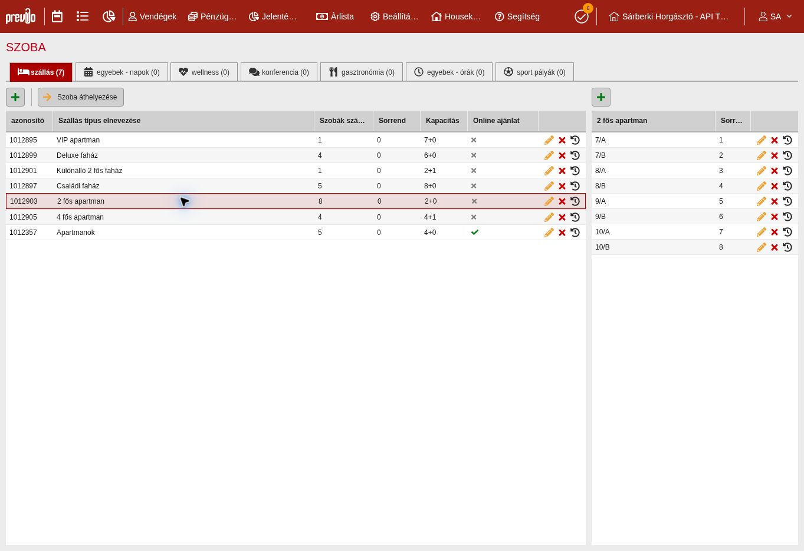

# Previo 73521 TEST – 6 típus és 23 egység felvétele
Feladó: Work → Claude és tulajdonos. Ellenőrzés: 2026-11-07 09:41 CET.

| Ellenőrzés | Bizonyíték | Eredmény |
|---|---|---|
| Kiindulás | 1012357 Apartmanok, 4+0, 5 mintapartman | IGAZOLT UI |
| Meglévő megoldás / választás | Previo webes Beállítások → Hotel → Szoba; nincs új integráció vagy API-írás | Legegyszerűbb engedélyezett út |
| Előzetes engedély | V1-ALLAPOT, 9c7266e; Online KI: 9b4931e; ideiglenes NTAK: 90c5a22; Claude #9 6704278010 | Végrehajtás előtt ellenőrizve |
| Új szerkezet | 6 típus, 23 név szerint ellenőrzött egység | PASS |
| Tartós mentés | Újratöltött oldal → minden típus kiválasztva → egységnévlista és kapacitás, NTAK-adatlap visszaolvasva | PASS |
| Online ajánlat | Mind a 6 új típusnál KI; eredeti Apartmanok BE, változatlan | PASS, képi bizonyíték |
| Eredeti egységek | Apartman 1, 2, 3, 4, 5 megmaradt | PASS |
| Végső darabszám | 7 típus / 28 egység = eredeti 1/5 + új 6/23 | PASS |
| Egyedi egység-ID-k | A beállítási rács nem mutatja őket | NEM IGAZOLT; Claude olvasó GET-tel gyűjti |
| API, szabad hely, ár | E munkában nem hívtuk / nem vizsgáltuk | NEM IGAZOLT |

## Új típusok és egységek
| Previo típus-ID | Típus | Ágy+pótágy | Ideiglenes NTAK | Egységnevek |
|---|---|---|---|---|
| 1012895 | VIP apartman | 7+0 | UDULOHAZ | 1 |
| 1012897 | Családi faház | 8+0 | UDULOHAZ | 2, 3, 4, 5, 6 |
| 1012899 | Deluxe faház | 6+0 | UDULOHAZ | 11, 12, 13, 14 |
| 1012901 | Különálló 2 fős faház | 2+1 | UDULOHAZ | 15 |
| 1012903 | 2 fős apartman | 2+0 | APARTMAN | 7/A, 7/B, 8/A, 8/B, 9/A, 9/B, 10/A, 10/B |
| 1012905 | 4 fős apartman | 4+1 | APARTMAN | 7/C, 8/C, 9/C, 10/C |

Tételes, friss UI-visszaolvasás: [verified-ui.json](verified-ui.json). Nem API-válasz, nem szabadhely-igazolás.
Az A/B nevek a fizikai házszámot jelölik; azonos házban szabad A+B párra ebből még nem következik rendelkezésre állás.

## Korlát és következő feladat
- Claude külön tulajdonosi jóváhagyással futtassa a már ismert 3 olvasó GET-et a 73521-en. **Összesen 28 egységet várjon**, ebből az 5 Apartman mintát különítse el; a 23 Sárberki-egységre kérjük a roomId → név → roomKindId megfeleltetést.
- A hat új típus fenti ID-i használhatók ellenőrzési alapként; az éles típus-ID-k nem TEST-ID-k. PREVIO_READ_API_ENABLED változatlanul KI.
- Az NTAK-besorolás tulajdonos által engedélyezett **ideiglenes TEST-adat**, nem az éles besorolás bizonyítéka; későbbi igazítás külön engedéllyel.
- Nem hoztunk létre foglalást/vendéget, nem állítottunk árat vagy csatornát, nem aktiváltunk NTAK-kapcsolatot/jelentést; éles 753011-et nem nyitottuk meg. Alkalmazáskód, adatbázis és Netlify változatlan.
